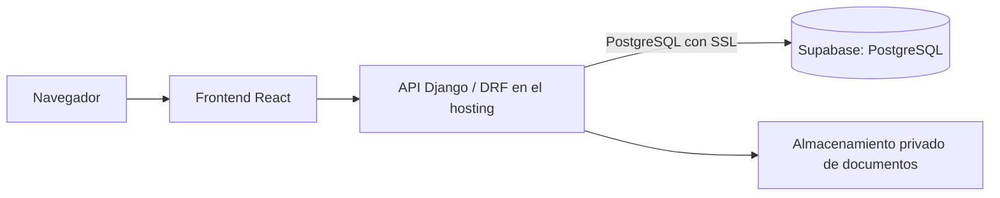

# Decisión de arquitectura: PostgreSQL administrado en Supabase

Estado: aprobado por el responsable del proyecto el 1 de noviembre de 2026.

## Texto para el informe

La plataforma de la Fundación Apoyo Comunitario utiliza PostgreSQL, administrado mediante Supabase, como solución definitiva de base de datos. Esta decisión centraliza la información y permite que los integrantes del equipo trabajen sobre los mismos registros. El despliegue de la aplicación en el hosting mantendrá la base de datos en Supabase; no contempla trasladarla al servidor web.

El backend, desarrollado en Django y Django REST Framework, accede a PostgreSQL mediante el ORM de Django y el controlador psycopg. El frontend React consume exclusivamente la API del backend y no recibe credenciales de conexión a la base de datos. La autenticación de usuarios, la asignación de roles y las reglas de autorización permanecen en Django y django-allauth; Supabase se utiliza como proveedor de PostgreSQL, sin reemplazar estos componentes por Supabase Auth.

La información persistente comprende usuarios, perfiles de voluntarios y solicitantes, catálogos, disponibilidad, solicitudes, actividades, invitaciones, participaciones, respaldos, notificaciones e historial de operaciones. El modelo relacional utiliza claves foráneas, restricciones de integridad y transacciones. Las operaciones de asignación de cupos y actualización concurrente utilizan bloqueos de filas en PostgreSQL y revisiones de los registros para evitar sobreasignaciones y sobrescrituras.

El backend se conecta al endpoint PostgreSQL de Supabase mediante una conexión cifrada. La configuración compartida actual utiliza el Session pooler en el puerto 5432 y `sslmode=require`, que exige cifrado de transporte. Este modo no equivale a verificar la identidad del servidor mediante un certificado y nombre de host; para esa verificación se deberá configurar `verify-full` y su certificado correspondiente. Las credenciales se mantienen en archivos de entorno privados y no se incorporan al repositorio ni al código del navegador.

La elección de Supabase desacopla la persistencia del servidor que aloja la aplicación y facilita el trabajo colaborativo. El hosting ejecutará el backend y servirá el frontend, mientras que PostgreSQL permanecerá en Supabase. SQLite se conserva únicamente como herramienta de pruebas aisladas y desarrollo sin conexión; no es la base operativa compartida ni la base prevista para producción.

## Distribución de componentes

Los archivos PDF e imágenes no se almacenan automáticamente en PostgreSQL por utilizar Supabase. Actualmente se guardan en almacenamiento privado del backend y la base contiene sus referencias y metadatos. Todavía se debe definir e implementar el almacenamiento compartido de archivos antes del despliegue; Supabase Storage es un servicio distinto y no está integrado en esta versión.

## Desarrollo y producción

- **Trabajo colaborativo actual:** proyecto Supabase compartido, ya conectado y con los datos locales importados y verificados.
- **Producción:** PostgreSQL en Supabase. Antes de publicar, preparar un entorno separado del desarrollo para no mezclar pruebas con información operativa. La separación de entornos no exige cambiar de motor ni proveedor.
- **Pruebas:** SQLite aislado para las comprobaciones locales y PostgreSQL desechable en integración continua para validar concurrencia. Las pruebas no se ejecutan sobre los datos compartidos de Supabase.
- **Hosting:** frontend, backend, HTTPS, correo y servicios auxiliares. No necesita alojar un servidor PostgreSQL para esta arquitectura.

## Pendientes de puesta en producción

La decisión de proveedor no implica que la plataforma esté desplegada o que todos los controles de producción estén configurados. Quedan por completar: separación de entornos, permisos mínimos de la cuenta de conexión, verificación TLS con certificado si se adopta `verify-full`, almacenamiento privado compartido, política de respaldo y retención, prueba de restauración, monitoreo, SMTP y configuración del hosting.

Un respaldo de PostgreSQL y un respaldo de los documentos son componentes diferentes. Su programación, ubicación y procedimiento de recuperación deben quedar documentados y probarse antes de operar con datos reales. No se atribuyen al proyecto garantías de disponibilidad, certificaciones ni respaldos automáticos que no se hayan contratado y verificado.

Referencias técnicas: [conexiones PostgreSQL en Supabase](https://supabase.com/docs/guides/database/connecting-to-postgres), [modos SSL](https://supabase.com/docs/guides/platform/ssl-enforcement), [respaldos](https://supabase.com/docs/guides/platform/backups).
